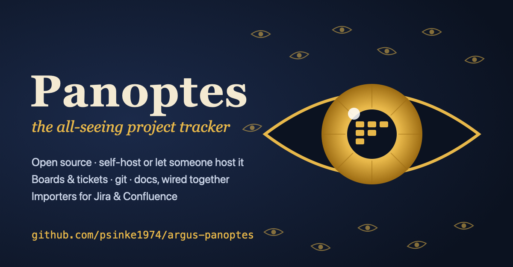

<p align="center"></p>

# 👁 Panoptes

> *the all-seeing project tracker*

Argus Panoptes, the giant with a hundred eyes, never closed all of them at once. Jira has a hundred configuration screens and nobody remembers which screen controls which eye. Panoptes takes the middle road: open source, hostable in the EU (or anywhere you like), with projects and boards, git and documentation wired together. No labyrinth of workflow schemes, permission schemes and screen schemes (the Labyrinth of Knossos had fewer turns, and Theseus at least had a thread).

It is built on [OpenProject](https://www.openproject.org) (GPLv3) and [Gitea](https://about.gitea.com) (MIT), with our own glue and an importer for Jira and Confluence. For anyone who wants to leave the underworld without leaving their history behind: the importer is your Charon.

| Myth | In Panoptes |
|---|---|
| Argus' hundred eyes | `glue/`: sees every commit and pull request and updates the tickets |
| Ariadne's thread | `OP#123` and old `PROJ-12` keys lead from git back to the ticket |
| Charon, the ferryman | `panoptes_import/`: carries Jira and Confluence across |
| The Augean stables | Workflow schemes, field configurations and screen schemes |
| Sisyphus | A backlog that never empties (here too, but it rolls more lightly) |

> **Status: early.** The importers are tested against our own fixtures and a fake Atlassian API (`tests_import/mock_atlassian.py`), not yet against a real Jira/Confluence instance or a real customer export. Reports of what breaks are very welcome.

| Component | Based on | License | URL (local dev) |
|---|---|---|---|
| Work packages, boards, wiki | OpenProject | GPLv3 | http://localhost:8080 |
| Git | Gitea | MIT | http://localhost:3000 |
| Integration + extras | `glue/` (FastAPI) | GPLv3 | http://localhost:8090 |

## Try it in about 5 minutes
You need Docker (at least 4 GB RAM available to it), Python 3.10+, and free ports 80 and 443.

```bash
git clone https://github.com/psinke1974/argus-panoptes.git && cd argus-panoptes
python3 deploy/tenantctl.py create demo      # first start pulls images: a few minutes
```
This starts a complete, isolated stack with HTTPS on your machine and prints the URLs and where the generated credentials are (`tenants/demo/.env`):
OpenProject at `https://demo.localhost`, Gitea at `https://git.demo.localhost`, the docs portal at `https://docs.demo.localhost`. Your browser will warn about the local certificate authority; accept it for this trial.

Want something to look at without a real Jira? Import the bundled fake Jira/Confluence:
```bash
pip install -r panoptes_import/requirements.txt
python3 tests_import/mock_atlassian.py &                 # fake Jira/Confluence API on :8099
export ATLASSIAN_TOKEN=dummy
python3 -m panoptes_import --env tenants/demo/.env jira-api --url http://localhost:8099 --email a@b.nl --project API --identifier api-demo
python3 -m panoptes_import --env tenants/demo/.env confluence-api --url http://localhost:8099 --email a@b.nl --space TEAM --repo panoptes/confluence-demo
```
Then open the OpenProject project `api-demo` and the docs portal at `https://docs.demo.localhost/docs/panoptes/confluence-demo`.

`python3 deploy/tenantctl.py destroy demo --yes` removes it all again.

<details>
<summary>Single-stack development setup (without the proxy)</summary>

```bash
cp .env.example .env            # set OP_SECRET_KEY_BASE (openssl rand -hex 64) and WEBHOOK_SECRET
docker compose up -d --build
```
1. OpenProject: log in as `admin` / `admin`, change the password immediately, create an API token (My account > Access tokens) and put it in `.env` as `OP_API_KEY`.
2. Gitea: create an admin with `docker compose exec -u git gitea gitea admin user create --admin --username ... --password ... --email ...`, create a token and put it in `.env` as `GITEA_TOKEN`.
3. `docker compose up -d glue`, then add a webhook in your Gitea repo: `http://glue:8090/hooks/gitea`, secret = `WEBHOOK_SECRET`, events: push + pull request.
</details>

## What it does
- `OP#123` in a commit or PR text: comment with a link on work package 123.
- After a Jira import the old keys work too: `fixes PROJ-12` in a commit or PR is translated to the new work package through `.import-state/` (only keys the importer knows).
- PR opened: status moves to *In progress*. `fixes OP#123` + merge (or a push to the default branch): status moves to *Closed*.
- `GET /release-notes?repo=owner/name&base=v1&head=v2`: Markdown release notes grouped by work package type.
- `GET /stale?project=<identifier>&days=30` (`&format=json` for machines): open work packages nobody has touched for N days, grouped by assignee. Commits and PR notes from the glue count as activity, so git work keeps tickets fresh.
- **Weekly stale-ticket digest:** every Monday (configurable) the glue posts the stale report to a Slack-compatible webhook (Slack, Mattermost, Rocket.Chat) and/or e-mails it. Configure per tenant: `python3 deploy/tenantctl.py digest acme --projects proj1,proj2 --webhook-url https://hooks.slack.com/... --tz Europe/Amsterdam` (or `--smtp-host ... --to a@x.com,b@x.com`; `--off` to disable). Preview with `GET /digest/preview`, send now with `POST /digest/send` (administrators). It sends once per day at most, also across restarts.
- Docs-in-repo: Markdown in `docs/` (and the repo root) is served at `http://localhost:8090/docs/<owner>/<repo>` with navigation, search and a list of related work packages (from the commits that touched the file). A commit with `OP#123` that changes docs adds a link to that page on the work package.
  - Deliberate choice: the OpenProject API can only read wiki pages, not write them. Git is therefore the source of truth and the glue provides the reading portal.

## Atlassian importer
Runs locally (`pip install -r panoptes_import/requirements.txt`, reads `.env`).

```bash
# Jira: Issues > Export > CSV (all fields)
python -m panoptes_import jira export.csv --identifier proj --project-name "My project" --dry-run
python -m panoptes_import jira export.csv --identifier proj --project-name "My project" [--user-map users.csv]

# Confluence: Space settings > Export space > HTML
python -m panoptes_import confluence space-export.zip --space-name TEAM --repo owner/name
```
- **Jira:** types, statuses and priorities are mapped (English and Dutch OpenProject installs; unknown values fall back and are reported), hierarchy (epic/parent), comments, `blocks`/`duplicates`/`relates` links. Titles get a `[PROJ-123]` prefix so old keys stay searchable. Jira wiki markup becomes Markdown. Re-runnable: `.import-state/` remembers what was already created.
- **Users:** `--user-map` (CSV: `jira_name,op_login`) maps assignees; otherwise the name goes into the description.
- **Confluence:** the page tree becomes a folder structure in `docs/`, attachments go to `docs/_attachments/`, links between pages keep working, info/warning panels, code blocks and tables become Markdown. The result shows up in the docs portal right away.
- **Straight from the API** (no export needed): put your token in the environment and run
  ```bash
  export ATLASSIAN_TOKEN=...            # Cloud: id.atlassian.com > Security > API tokens
  python -m panoptes_import jira-api --url https://yourcompany.atlassian.net --email you@yourcompany.com --project PROJ --identifier proj
  python -m panoptes_import confluence-api --url https://yourcompany.atlassian.net --email you@yourcompany.com --space TEAM --repo owner/name
  ```
  Jira Server/Data Center: use `--server` and omit `--email` (Personal Access Token as Bearer). Also imports attachments and matches assignees on e-mail address when Jira returns it. Confluence macros that have no Markdown equivalent are reported instead of silently dropped.
- **Not (yet):** worklogs, issue history, custom fields, workflows, Confluence comments and permissions, Confluence XML export.
- Enabling work package types per project is not possible through the OpenProject API; the importer does it with `scripts/op-enable-types.sh`.

## Hosting: one isolated stack per customer
The same code runs on a customer's own server (self-hosted) or as a hosted service you offer. Each customer ("tenant") gets its own OpenProject, Gitea and glue, behind one shared Caddy proxy with automatic HTTPS. Isolation, backups and exports are per customer.

```bash
python3 deploy/tenantctl.py create acme --admin-email admin@acme.com         # local trial: https://acme.localhost
python3 deploy/tenantctl.py create acme --base-domain panoptes.example.com   # production: acme.panoptes.example.com
python3 deploy/tenantctl.py list
python3 deploy/tenantctl.py backup acme                                      # stops the stack ~1 min, writes backups/acme-<timestamp>.tar
python3 deploy/tenantctl.py restore acme backups/acme-<timestamp>.tar --yes  # replaces all data of the tenant
python3 deploy/tenantctl.py destroy acme --yes                               # removes containers AND data
```
- Creates `acme.<base>` (OpenProject), `git.acme.<base>` (Gitea, HTTPS clone only) and `docs.acme.<base>` (docs portal), generates all secrets in `tenants/acme/.env` (chmod 600) and bootstraps the admin accounts and API tokens.
- Production needs wildcard DNS (`*.panoptes.example.com`) pointing at the server; Caddy then obtains Let's Encrypt certificates. Locally, `*.localhost` uses Caddy's internal CA (accept the browser warning, or run `caddy trust` inside the Caddy container's CA).
- Rough sizing: about 2 GB RAM per tenant for OpenProject, plus a little for Gitea and the glue.
- Without SSO the docs portal is protected with HTTP basic auth (`docs` / `DOCS_PASSWORD` in the tenant `.env`), because it reads all repositories with the service token. Webhooks are never reachable from outside. With SSO enabled (below) access is checked per user.
- Not built yet: scheduled/encrypted offsite backups, billing.

### Single sign-on (Keycloak)
```bash
python3 deploy/tenantctl.py enable-sso acme --admin-email admin@acme.com
```
Adds a bundled [Keycloak](https://www.keycloak.org) at `auth.acme.<base>` (realm `panoptes`, one client per app, a first administrator whose temporary password is in the tenant `.env`).
- **Git:** "Sign in with keycloak"; accounts are created on first sign-in (password sign-up stays disabled).
- **Docs portal:** real OIDC sign-in replaces the basic-auth password. Repository access is checked *as the signed-in user* through Gitea (`Sudo`), so people only see docs of repositories they may read. The stale-ticket report is limited to users with the Keycloak realm role `admin`. New SSO users must sign in to Git once before the portal can see their repositories.
- **OpenProject: not covered.** OpenProject's Community Edition has no OIDC/SAML login (it is an Enterprise feature, the container logs say so). OpenProject keeps its own logins. The OIDC provider is already configured, so it should start working once an Enterprise token is added, but that part is **untested**. A possible community-edition route is LDAP (OpenProject supports it); contributions welcome.
- Uses Keycloak's embedded database (fine for small tenants; back it up with `tenantctl backup`, it is included). Containers reach `auth.<host>` through the host's Caddy, with the proxy's CA added to their trust bundle for the local trial.
- Verified by `python scripts/sso_smoke.py acme`: real sign-ins to Git and the docs portal, per-user repository access (a private repo stays hidden), admin-only report, single sign-on across apps, sign-out.

## End-to-end tests
- `python scripts/e2e.py`: dev stack; creates a project, work package and repo and tests the whole chain.
- `python scripts/sso_smoke.py acme`: after `enable-sso`; drives real Keycloak sign-ins.
- `python scripts/digest_smoke.py acme`: configures the digest against a local receiver and checks what is delivered.
- `python scripts/tenant_smoke.py acme`: tenant stack; routing, docs-portal protection, webhook isolation, stale report and the git-to-ticket chain via an old Jira key.

## Roadmap
- Digest: per-assignee e-mails and Microsoft Teams format.
- EU-hosted LLM (e.g. Mistral): work package summaries and draft docs from closed tickets.
- SSO for OpenProject itself (needs Enterprise edition, or an LDAP route), scheduled offsite backups, billing.
- Test the importers against real Jira/Confluence exports.

## Tests
```bash
cd glue && python -m pytest        # integration glue
python -m pytest tests_import      # importers (use the fake Atlassian)
```

## Contributing
Issues and pull requests are welcome, especially: real-world import bug reports (anonymised exports help a lot), translations, and integrations (other git hosts, notifications, SSO). Keep user-facing text and code in English.

## License
GPL-3.0, see [LICENSE](LICENSE).
